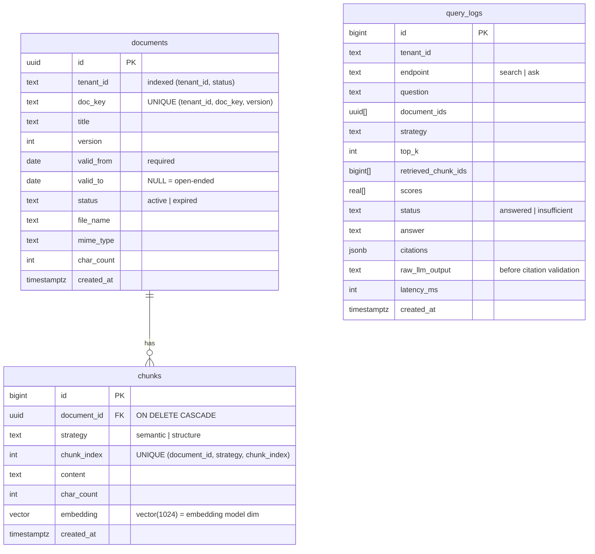

# NUSAskify — Internal Policy Q&A (RAG)

Upload policy documents → select documents → ask a question → get an answer with citations and the source chunks.
Answers "not enough information" instead of guessing.

## 1. Tech stack

| Layer | Choice | Why |
|---|---|---|
| Backend | Node.js 22 + TypeScript + Express 5 (run with `tsx`) | |
| Upload / parse | `multer` (memory), `pdf-parse` (PDF), `mammoth` (DOCX), own ODT parser on `jszip` (`content.xml` → headings/paragraphs) | Other file types → `415` with a clear message |
| Chunking | `@chonkiejs/core` — `SemanticChunker` (semantic) and `RecursiveChunker` (structure) | Same library for both → fair comparison |
| Vector store | PostgreSQL 17 + `pgvector` (Docker) | Metadata filter = plain SQL `WHERE` in the same query as the vector ordering |
| Models (local) | Ollama — `qwen3-embedding:0.6b` (1024-d), `qwen3:4b-instruct` | Same embedding model for chunking, indexing and querying |
| Validation | `zod` | Missing metadata → `422`, document not indexed |
| API docs | `swagger-jsdoc` + `swagger-ui-express` → **http://localhost:3000/api-docs** | |
| Frontend | React 19 + Vite 7 | |

## 2. How to run

Prerequisites: Node ≥ 22 (`nvm use`), Docker, [Ollama](https://docs.ollama.com/quickstart).

```bash
# 0. models
ollama pull qwen3-embedding:0.6b
ollama pull qwen3:4b-instruct

# 1. database (Postgres + pgvector on host port 5434)
docker compose up -d

# 2. backend → http://localhost:3000  (Swagger: /api-docs). Tables are created on startup.
cd backend
cp .env.example .env
npm install
npm run dev

# 3. frontend → http://localhost:5173
cd ../frontend
npm install
npm run dev

# 4. sample data + test cases (from backend/, with the backend running)
npm run sample-docs                       # writes sample_docs/*.pdf|docx|odt
npm run seed                              # uploads them for tenants acme + globex
npm run test-cases                        # TC1–TC8 → tests/results/test-results-semantic.md
STRATEGY=structure npm run test-cases     # same with structure-based chunks
```

## 3. Architecture & flow

```mermaid
flowchart LR
  UI[React UI<br/>tenant selector · upload · doc checkboxes · ask] -- "X-Tenant-Id" --> API[Express API]
  API --> PARSE[parse<br/>pdf-parse / mammoth / odt]
  PARSE --> CHUNK[chunk<br/>semantic + structure]
  CHUNK --> EMB[(Ollama<br/>qwen3-embedding)]
  CHUNK --> PG[(Postgres + pgvector)]
  API -- "/api/search, /api/ask" --> RET[retrieve<br/>filter + top-k in ONE SQL]
  RET --> PG
  RET --> GATE{best score<br/>≥ MIN_SCORE?}
  GATE -- no --> NEI[status: insufficient]
  GATE -- yes --> LLM[(Ollama<br/>qwen3 chat)]
  LLM --> VAL[validate citations<br/>drop [n] not retrieved]
  VAL --> API
  API --> LOG[(query_logs)]
```

**`/api/ask` step by step**

1. Tenant from `X-Tenant-Id` (missing → 400).
2. Embed the question with the same model used for chunks.
3. One SQL query: `WHERE tenant_id = $tenant AND id = ANY($selected) AND status='active' AND today ∈ [valid_from, valid_to] AND strategy = $s ORDER BY embedding <=> $q LIMIT k` → **filter before top-k**.
4. Gate 1 (retrieval): no chunk, or best cosine similarity < `MIN_SCORE` → `insufficient` without calling the LLM.
5. LLM gets numbered passages `[1]..[k]`, must cite each claim and reply `NOT_ENOUGH_INFO` if the context does not answer → Gate 2.
6. Gate 3 (citations): `[n]` markers outside `1..k` are removed; no valid citation left → `insufficient`.
7. Everything (chunk ids, scores, raw LLM output, final answer) is written to `query_logs`.

**Design notes**

- *No HNSW index on purpose.* With an approximate index pgvector filters **after** the index scan, so a filtered top-k can return fewer than k rows (or miss the right chunk). An exact scan is fast at this size and guarantees filter-before-top-k.
- *Versioning.* `doc_key` groups versions. Uploading a higher version marks older ones `expired`; retrieval also checks `valid_from/valid_to`, so a document whose validity window has ended is excluded even if it is still `active`.
- *Tenant isolation.* Every query is scoped by `tenant_id`; another tenant's document ids return 404 / zero chunks.

## 4. Database



## 5. API

| Method | Path | Purpose |
|---|---|---|
| POST | `/api/documents` | multipart: `file` (.pdf/.docx/.odt) + `title`, `doc_key`, `version`, `valid_from`, `valid_to?` → ingestion |
| GET | `/api/documents` | Tenant's documents (+ `is_current`, chunk counts) |
| GET | `/api/documents/:id/chunks?strategy=` | Chunks of a document (debug) |
| DELETE | `/api/documents/:id` | Delete document + chunks (cascade) |
| POST | `/api/search` | `{ question, document_ids?, top_k, strategy }` → chunks with scores (no LLM) |
| POST | `/api/ask` | `{ question, document_ids?, top_k, strategy }` → `{ status, answer, citations, chunks }` |

Interactive docs: **http://localhost:3000/api-docs** (OpenAPI JSON at `/openapi.json`).

## 6. Sample documents

| Tenant | File | doc_key | v | Valid | Purpose |
|---|---|---|---|---|---|
| acme | `acme_remote-work_v1_2024.pdf` | remote-work | 1 | 2024-01-01 → 2025-12-31 | **expired** version (2 days/week) — TC4 |
| acme | `acme_remote-work_v2_2026.docx` | remote-work | 2 | 2026-01-01 → | current version (3 days/week) — TC1/TC4 |
| acme | `acme_annual-leave_v1_2026.docx` | annual-leave | 1 | 2026-01-01 → | paid vs. unpaid leave — TC6/TC8 |
| acme | `acme_travel-expense_v1_2026.pdf` | travel-expense | 1 | 2026-01-01 → | TC6 |
| globex | `globex_remote-work_v1_2026.docx` | remote-work | 1 | 2026-01-01 → | **other tenant** (5 days/week) — TC5 |
| globex | `globex_travel-expense_v1_2026.odt` | travel-expense | 1 | 2026-01-01 → | ODT format demo |

Paraphrase test: documents say "remote work", questions ask about "working from home".

## 7. Semantic vs. structure-based chunking

> TODO: fill in after running both strategies.

Settings: semantic `threshold=…`, `chunkSize=…`; structure `chunkSize=…`.

| Question | Semantic: rank of right chunk / score | Structure: rank / score | Notes |
|---|---|---|---|
| How many days a week can I work from home? | | | |
| … | | | |

| Metric | Semantic | Structure |
|---|---|---|
| # chunks (all docs) | | |
| avg chunk length (chars) | | |
| chunks that mix two topics | | |

Observations: TODO

## 8. Test results (TC1–TC8)

Raw evidence: `tests/results/test-results-semantic.md` (generated by `npm run test-cases`).

| # | Scenario | Result | Evidence / explanation |
|---|---|---|---|
| TC1 | Paraphrased question | | |
| TC2 | `/api/search` top 3 + why it matches | | |
| TC3 | Not covered → not enough information | | |
| TC4 | Expired vs. current version | | |
| TC5 | Other tenant | | |
| TC6 | Only doc A selected, ask about doc B | | |
| TC7 | Citations point to supporting chunks | | |
| TC8 | Similarity failure mode | | |

### Diagnosing: retrieval or generation?

For a wrong answer, open its `query_logs` row (`log_id` is returned by every call):

1. Is the right chunk in `retrieved_chunk_ids`? **No** → retrieval problem (chunking, embedding, threshold, filter).
2. **Yes**, but the answer is wrong or uncited → generation problem (prompt, model, context order). Compare `raw_llm_output` with the final `answer` to see which citations were dropped.

```sql
SELECT id, question, status, retrieved_chunk_ids, scores, answer, raw_llm_output
FROM query_logs ORDER BY id DESC LIMIT 10;
```
